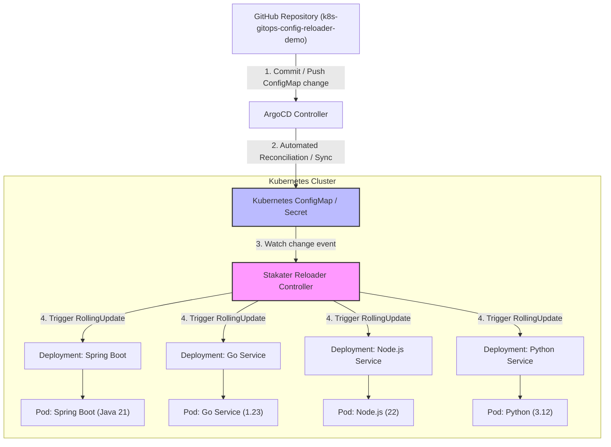
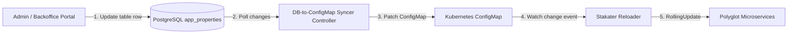

# Kubernetes GitOps & Stakater Reloader Polyglot Demo

A complete, production-grade cloud-native reference project demonstrating **zero-code, language-agnostic configuration management** across polyglot microservices (**Spring Boot / Java 21**, **Go 1.23**, **Node.js 22**, and **Python 3.12 FastAPI**) using **Kubernetes ConfigMaps/Secrets**, **Stakater Reloader**, and **ArgoCD GitOps**.

---

## 1. Why this Architecture? (Comparison with Spring Cloud Bus)

| Dimension | Spring Cloud Config + Bus Architecture | Cloud-Native GitOps + Reloader Architecture |
| :--- | :--- | :--- |
| **Non-Java Services (Go, Node, Python)** | **High Code Burden**: Must write custom AMQP clients, exchange bindings, queue listeners, and Jackson/JSON parsers. | **Zero Code**: Standard `os.Getenv`, `process.env`, or local JSON/YAML reading. |
| **Java / Spring Boot** | Requires `spring-cloud-starter-config` and `spring-cloud-starter-bus-amqp`. | Standard `@ConfigurationProperties` or `@Value` injected via Kubernetes. |
| **Infrastructure Overhead** | Dedicated Config Server cluster + RabbitMQ/Kafka broker instances. | Native Kubernetes primitives (ConfigMaps & Secrets) + lightweight Reloader controller. |
| **Dynamic Updates** | Event broadcast over message bus triggers `@RefreshScope` rebinds in memory. | ConfigMap change triggers an automated, zero-downtime Kubernetes `RollingUpdate`. |
| **State Drift & Self-Healing** | Requires custom sync checks. | **ArgoCD** continuously reconciles Git state with the live cluster. |

---

## 2. Architecture Diagrams

### A. GitOps: GitHub Repository -> ArgoCD -> ConfigMap -> Reloader


### B. Database-Driven: PostgreSQL -> DB-Syncer -> ConfigMap -> Reloader


---

## 3. Core Components Explained

| Component | Type | Source / Location | Purpose |
| :--- | :--- | :--- | :--- |
| **Stakater Reloader (`reloader-reloader` pod)** | Open-Source Controller | [stakater/Reloader](https://github.com/stakater/Reloader) (Go) | Watches K8s API for ConfigMap/Secret changes and triggers zero-downtime rolling updates on annotated Deployments (`reloader.stakater.com/auto: "true"`). |
| **DB Syncer (`services/db-syncer`)** | Custom Controller (in this repo) | [services/db-syncer/](services/db-syncer) (Python) | Bridges PostgreSQL (`app_properties` table) ➔ Kubernetes ConfigMaps. Queries SQL changes and patches ConfigMaps in Kubernetes. |
| **ArgoCD** | Open-Source GitOps Controller | [argoproj/argo-cd](https://github.com/argoproj/argo-cd) | Bridges GitHub ➔ Kubernetes. Continuously reconciles declarative manifests from this GitHub repository into the cluster. |
| **PostgreSQL Database** | Database | [k8s/db/postgres.yaml](k8s/db/postgres.yaml) | Stores runtime configuration rows (`app_properties` table) for database-driven scenarios. |
| **Polyglot Microservices** | Applications | [services/](services/) | Spring Boot (Java 21), Go 1.23, Node.js 22, Python 3.12 FastAPI consuming ConfigMaps via standard environment variables and volume mounts. |

### How `services/db-syncer` and `reloader-reloader` Cooperate:
```
1. SQL Database (PostgreSQL)
      │
      ▼
2. services/db-syncer        <-- Custom Python controller (in this repo)
      │  (Patches K8s ConfigMap)
      ▼
3. Kubernetes ConfigMap
      │  (Detects ConfigMap update event)
      ▼
4. reloader-reloader         <-- Stakater open-source controller
      │  (Triggers RollingUpdate)
      ▼
5. Polyglot Microservices    (Spring Boot, Go, Node, Python)
```

---

## 4. Project Structure

```
k8s-gitops-config-reloader-demo/
├── services/
│   ├── springboot-service/         # Java 21 (0 lines of Config Server / RabbitMQ code)
│   ├── go-service/                 # Go 1.23 (0 lines of AMQP or custom client code)
│   ├── node-service/               # Node.js 22 Express (Pure JSON / env reading)
│   ├── python-service/             # Python 3.12 FastAPI (Standard env reading)
│   └── db-syncer/                  # Custom Python DB-to-ConfigMap Reconciler Controller
│       ├── syncer.py               # Connects to PostgreSQL and patches K8s ConfigMaps
│       ├── Dockerfile              # Container image gitops-demo-db-syncer:latest
│       └── requirements.txt        # psycopg2-binary, kubernetes client library
├── k8s/
│   ├── base/
│   │   ├── namespace.yaml          # gitops-demo namespace
│   │   ├── configmaps.yaml         # ConfigMaps for all 4 services
│   │   ├── secrets.yaml            # Secret for API tokens
│   │   ├── springboot-service.yaml # Workload with reloader.stakater.com/auto: "true"
│   │   ├── go-service.yaml
│   │   ├── node-service.yaml
│   │   ├── python-service.yaml
│   │   └── kustomization.yaml
│   ├── db/
│   │   ├── postgres.yaml           # PostgreSQL deployment & initial SQL seed
│   │   └── db-syncer.yaml          # RBAC & Deployment for DB-to-ConfigMap Syncer
│   └── overlays/
│       └── minikube/
│           └── kustomization.yaml
├── gitops/
│   ├── app-project.yaml            # ArgoCD project definition
│   └── application.yaml            # ArgoCD sync pipeline
└── scripts/
    ├── setup-minikube.sh           # Installs Stakater Reloader & ArgoCD into Minikube
    ├── deploy.sh                   # Builds images, loads into Minikube, deploys workloads
    ├── test-gitops-reload.sh       # Automated polyglot verification test showing live reload
    ├── test-github-sync.sh         # Verifies GitHub -> ArgoCD -> ConfigMap sync
    ├── setup-db-sync.sh            # Deploys PostgreSQL & DB-to-ConfigMap Syncer
    ├── test-db-sync.sh             # Updates SQL row & verifies live pod rollout
    └── teardown.sh                 # Cleans up workloads & infrastructure
```

---

## 4. Hands-on Testing Guide

### Scenario 1: Basic In-Cluster Polyglot Reload Test
```bash
# 1. Setup Minikube with Reloader & ArgoCD:
./scripts/setup-minikube.sh

# 2. Deploy all 4 polyglot microservices:
./scripts/deploy.sh

# 3. Run acceptance test:
./scripts/test-gitops-reload.sh
```

---

### Scenario 2: Test ConfigMap + GitHub Repository Sync (ArgoCD GitOps)
In this scenario, GitHub is the single source of truth.

#### Access the ArgoCD Web Dashboard:
1. **Port-forward the UI** (if not already running):
   ```bash
   kubectl -n argocd port-forward svc/argocd-server 8080:443
   ```
2. **Open in browser:** [https://localhost:8080](https://localhost:8080)
   * **Username:** `admin`
   * **Password:** Retrieve dynamically with:
     ```bash
     kubectl -n argocd get secret argocd-initial-admin-secret -o jsonpath='{.data.password}' | base64 -d && echo
     ```

#### Run the Acceptance Test:
```bash
# 1. Verify ArgoCD application is connected to GitHub:
kubectl -n argocd get application gitops-polyglot-config-demo

# 2. Run the automated GitHub sync test script:
./scripts/test-github-sync.sh

# 3. Manual Live Test in GitHub:
# Edit k8s/base/configmaps.yaml on GitHub or locally, commit & push:
git commit -am "chore: update config in GitHub" && git push origin main

# ArgoCD automatically syncs within 3 minutes (or click 'Sync' / 'Refresh' in UI or run):
kubectl -n argocd patch application gitops-polyglot-config-demo --type merge -p '{"operation":{"sync":{"prune":true}}}'

# Observe Stakater Reloader automatically rolling out new pods!
```

---

### Scenario 3: Test ConfigMap + Database Table Sync (PostgreSQL)
In this scenario, a database table (`app_properties`) is the source of truth (e.g., from an Admin portal).

```bash
# 1. Deploy PostgreSQL and DB-to-ConfigMap Syncer:
./scripts/setup-db-sync.sh

# 2. Run the automated database sync acceptance test:
./scripts/test-db-sync.sh

# 3. Manual SQL Test:
kubectl -n gitops-demo exec -it deploy/postgres -- psql -U postgres -d configdb
# Inside psql:
UPDATE app_properties SET prop_value = 'Live message from DBA!' WHERE prop_key = 'APP_MESSAGE';
\q

# Watch DB-Syncer detect the row update, patch the ConfigMap, and Reloader restart Spring Boot!
```

---

## 5. Clean Teardown
```bash
# Tear down demo workloads only:
./scripts/teardown.sh

# Tear down everything including ArgoCD & Reloader:
./scripts/teardown.sh --all
```
